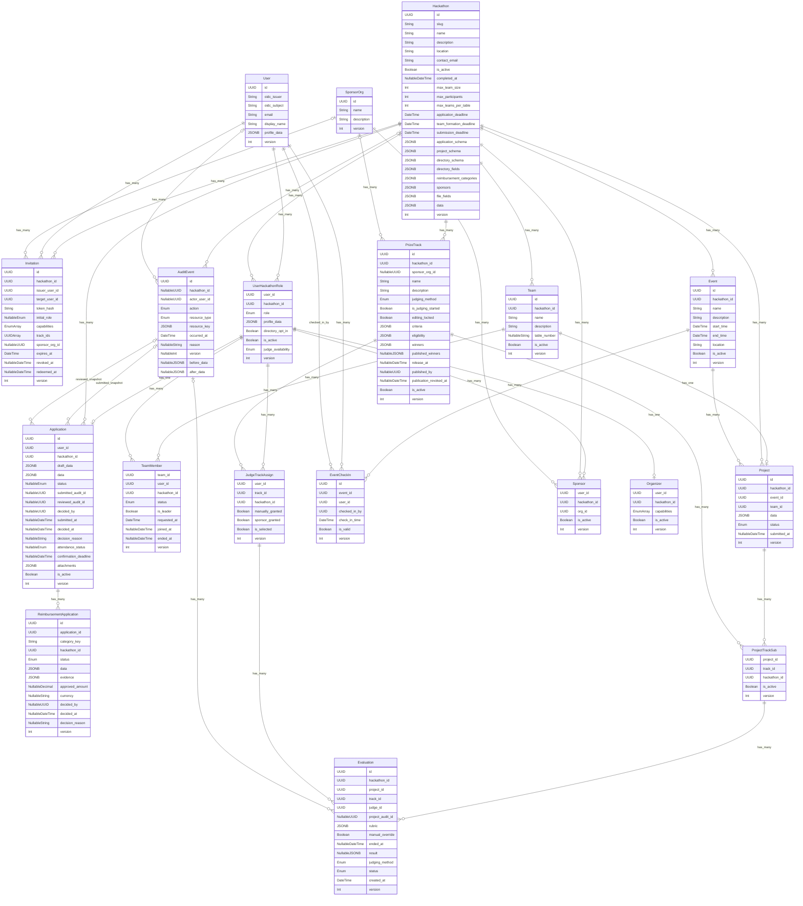

# RFC 0008: Database Model

- **Status:** Accepted
- **Author(s):** @kritdass, @anish, @amzoeee
- **Created:** 2026-03-28
- **Updated:** 2026-11-21

## Overview

This RFC establishes the database model that the Terrier application will use.

## Motivation

Terrier is a very complex application, requiring several interconnected tables with related data to work. Having a strictly defined, scalable schema and a clear workflow for generating database entities is critical for maintaining data integrity and accelerating backend development.

## Goals

- Define the core entities, relationships, and schema for the Terrier application
- Establish a single source of truth for the database architecture
- Automate the generation of Rust database entities to minimize boilerplate
- Ensure type-safe, asynchronous database interactions using SeaORM

## Non-Goals

- Deciding on the physical database hosting provider or infrastructure
- Defining the exact business logic or API routes that will interact with this data
- Writing raw SQL queries for standard CRUD operations

## Detailed Design

The diagram below defines the target schema reconciled with RFCs 0010 and 0011. It retains the eighteen existing tables and adds only AuditEvent. Forward migrations implement this schema; generated SeaORM entities reflect it. Domain routes and workflow policies are separate from schema support.

### Schema Source of Truth

Migrations establish the actual database structure; generated entities reflect that structure. Accepted RFCs establish required behavior. Changes to the schema must be reflected here and in a corresponding SeaORM migration.

Current state stays on existing records. One typed audit table preserves historical snapshots and recovery evidence. The constraints and workflow decisions below are part of the design, including rules not expressed by Mermaid relationships.

### Migrated Enums and Constraints

The generated enum reference reflects the migration values:

| Type | Values |
| -- | -- |
| `application_status` | `pending`, `accepted`, `rejected`, `waitlisted` |
| `attendance_status` | `pending`, `confirmed`, `declined`, `expired`, `revoked` |
| `audit_action` | `created`, `updated`, `deactivated`, `restored`, `automatic`, `accessed` |
| `audit_resource` | `user`, `hackathon`, `invitation`, `user_hackathon_role`, `application`, `reimbursement_application`, `team`, `team_member`, `project`, `sponsor_org`, `prize_track`, `project_track_sub`, `judge_track_assign`, `event`, `event_check_in`, `evaluation`, `sponsor`, `organizer` |
| `capability` | `application_management`, `judging_management`, `sponsorship_management`, `hackathon_admin` |
| `evaluation_status` | `pending`, `complete`, `skipped` |
| `hackathon_role` | `hacker`, `organizer`, `judge`, `sponsor` |
| `judge_availability` | `available`, `on_break` |
| `judging_method` | `scoring`, `expo` |
| `project_status` | `draft`, `submitted` |
| `team_member_status` | `active`, `invited`, `removed`, `pending`, `withdrawn`, `rejected` |

Legacy `invited`, `rejected` and `paid` values remain available for explicit mappings; new reimbursement denials use `denied`. `Invitation.initial_role` uses `hackathon_role`.

The migrations enforce identity/slug uniqueness, one application per user/hackathon, one project per team/hackathon, one reimbursement per application/category and one check-in per event/user. Partial unique indexes enforce one active membership or pending request per user/hackathon and one active leader per team. Composite foreign keys enforce same-hackathon relationships. Deferred triggers check final roster capacity/leadership and typed submission snapshot references at commit.

The reconciliation migration stops on populated legacy domain tables that need explicit workflow mappings. It preserves existing OIDC users and never invents actors, timestamps or decisions. All previous migrations remain unchanged.

### Fields and Integrity Rules

- User.profile_data holds global defaults. UserHackathonRole.profile_data and directory_opt_in hold hackathon-specific answers and publication consent. Organizer.capabilities holds additive responsibilities; UserHackathonRole remains the single primary-role classification. Primary organizer grants ordinary organizer access; management/admin implications are checked centrally. Existing organizer rows do not automatically become admins.
- Application holds draft_data separately from submitted data, current decision metadata, references to the submitted/reviewed audit snapshots, and attendance state/deadline. Autosave never replaces submitted or reviewed evidence. A permitted submitted edit preserves the earlier decision and highlights changes since review.
- TeamMember represents both pending requests and active membership. Keep its team/user key and add a partial unique user/hackathon key for pending or active status. This enforces one team, one pending request and their mutual exclusion. Leader flags require active membership; at most one active leader/team is enforced by a partial unique key, and transactions require exactly one for nonempty active teams. Oldest current joined_at succeeds a departing leader, with user UUID tie-breaker; last departure deactivates the team without withdrawing its project.
- Require unique User issuer/subject, Hackathon slug, Application user/hackathon, Project team/hackathon, EventCheckIn event/user and ReimbursementApplication application/category_key. Retain identities across deactivation/restoration. Same-hackathon composite FKs protect relational membership, event/project/track, sponsor and judging links.
- Hackathon.sponsors stores scoped company associations/settings using existing SponsorOrg IDs. A company can be associated before representatives or tracks exist. Sponsor gains hackathon scope; a company grant never applies to every hackathon. Non-sponsor tracks have a null sponsor. Invitation.track_ids and category/attachment/winner JSON references require transactional ID/scope validation; arrays and JSON do not provide per-element foreign keys.
- Existing Evaluation rows represent pending judging work and eventual results. Reassignment ends/skips the old row and creates another, preserving judge/project/track identity. Completion requires valid evaluation/rubric data and the exact project audit snapshot. Manual overrides persist until explicitly released. JudgeTrackAssign keeps independent manual/sponsor grant flags, deriving company from the track; break/selected-track state does not revoke authorization.
- PrizeTrack holds current winner selection and a separate published_winners snapshot with release/revocation metadata. Only checked publish/correct/revoke actions change publication fields. Winner edits cannot silently change a scheduled/public snapshot; public reads enforce release time and visibility and return only curated winner fields.

### Deactivation and Lifecycle State

Domain APIs use `PATCH` to change flags or lifecycle status. They do not expose `DELETE` or physically remove domain rows. Preserve primary keys, references and audit history; foreign keys must not cascade business deletions.

| Resource | Retained state |
| -- | -- |
| Hackathon, team, organizer, sponsor, track, event, application and project-track entry | Set `is_active` to false. Recheck each resource's lifecycle permissions and constraints. |
| Team membership | The API's `is_active: false` ends active membership by setting `TeamMember.status` to `removed`, clearing `is_leader` and recording `ended_at`. Do not add a second activity flag. |
| Join request | Use `TeamMember.status` values `pending`, `withdrawn` and `rejected`; acceptance changes `pending` to `active` and sets `joined_at`. Record the end time for withdrawal or rejection. The legacy `invited` value is retained but is not used for new requests. |
| Invitation | Set `revoked_at` to prevent future redemption; preserve any previously granted rights. |
| Judge track access | Clear only the applicable `manually_granted` or `sponsor_granted` flag. The other grant can still authorize access. |
| Check-in | Set `is_valid` to false through an authorized correction. Preserve attendance history. |
| Evaluation | End or skip work under the judging policy; preserve completed evidence. |
| Submitted project | No deletion or withdrawal, including when its team becomes inactive. |
| Communication channel | The future channel model must retain an inactive flag; its schema is still deferred. |

Every deactivation and related change commits with its audit entry and version update. Ordinary reads and authorization exclude inactive resources and ended relationships, including through inactive parents. Authorized history and recovery views may read retained records. Restoration is a checked transition, not permission to reset any flag arbitrarily. Team departure also handles leadership succession and deactivates an empty team atomically.

Retained rows continue to occupy their stable identities and uniqueness keys. Rejoining or requesting the same team again updates the existing team/user row through an allowed transition; audit snapshots retain earlier membership and request episodes. Do not delete old rows to bypass uniqueness constraints. Session/token cleanup and personal-data erasure remain separate lifecycle policies.

The flags, lifecycle states, timestamps, versions and audit table are migrated. Submitted projects still have no removal or withdrawal operation.

### Audit and Recovery

Application middleware supplies the authenticated actor through `Audit`. Handlers use `audited!` and its transaction connection; automatic jobs use `audited_automatic!` with a required reason. Transaction-local context cannot leak to the next pooled request. Database triggers append snapshots only after an insert/update succeeds, including conflict updates, and reject unaudited writes, physical deletion and truncation. Invitation hashes are omitted from snapshots. Project track changes create a new project snapshot containing the selected tracks.

Migrations and requests share the deployment's `DATABASE_URL` login, which owns the schema. Security-definer audit functions use a fixed schema search path with temporary objects last. Audit rows reject update/delete/truncate during normal DML. The triggers protect audit history from application writes, not from arbitrary SQL run as the owner.

AuditEvent records the actor, typed action/resource, stable resource key, time, optional reason/version and before/after snapshots. Structured resource keys support existing composite keys. Authenticated actions record their user; a null actor is reserved for an explicit automatic action. No separate service identity, request-correlation or before-version field is required.

Every persistent domain change and its audit record commit in the same transaction. Increment the current resource version and prevent duplicate mutation snapshots for the same canonical resource key/version. Read/access actions need no fabricated version. Creation and submission snapshots retain complete evidence: exact answers/content, applicable form definition and selected tracks. Decisions reference the exact submission reviewed; evaluation snapshots must match the evaluated project and hackathon. An arbitrary valid audit UUID is insufficient. Validate typed snapshot references and embedded IDs when writing them.

Audit payload access follows the underlying resource. Ordinary organizers must not gain draft or reimbursement access through history; sponsors cannot read unrelated tracks or private application answers through snapshots. Never store raw invitation tokens, credentials or cookies. Startup migrations remain serialized.

Recovery is a new authorized, version-checked mutation with a reason and audit entry. Recheck current scope, uniqueness, capacity and workflow constraints; do not overwrite intervening changes. Business deactivation is separate from retention/erasure policy. Forward migrations must diagnose duplicate/cross-scope legacy rows and use explicit mappings, never guessed actors/approvals/timestamps or automatic conflict deletion. Preserve the existing pre-OIDC identity-mapping prerequisite and do not rewrite shipped migrations.

### Workflow Decisions

These choices resolve the corresponding profile, sponsorship, invitation and reimbursement questions in RFCs 0010/0011 without introducing additional tables:

- Organizers define directory fields and the published fieldset. Participants opt in; confirmed attendees browse the directory within the same hackathon. Opt-out hides the profile immediately, including caches. Private applications/reimbursements remain separate, and mandatory team discovery/authorized organizer reads do not depend on directory opt-in.
- Sponsors manage/edit their company's tracks, invite track judges and invite additional sponsor representatives within that company/hackathon. No separate sponsor-manager tier or judge-company affiliation is needed. Sponsors see entered participants' email/resume, own-track aggregate scores and individual evaluations including judge names/notes. They do not gain other application answers, receipts, overall scores or other tracks' judging.
- Every invitation targets an existing Terrier account; the recipient must sign in as that exact user. Hash tokens, enforce expiry/revocation, recheck the issuer's current delegable authority, and grant/redemption/audit atomically. Initial role applies only to new hackathon membership; existing classification is preserved. Replay returns the recorded outcome without restoring revoked grants. Revoking an invitation prevents future redemption, not an implicit revocation of rights already granted.
- Attendance state lives on Application. Only unconfirmed pending offers expire; confirmed attendance survives its confirmation deadline. Declined reconfirmation needs a valid deadline; expired/revoked offers need explicit reopening. Every accepted-to-nonaccepted change, including reopening pending review, revokes the offer and cleans up team/request/leadership state atomically. Preserve check-ins/projects/evaluations/unrelated grants; reacceptance requires fresh confirmation without restoring old membership.
- Organizers configure reimbursement categories, allowed currencies and evidence in Hackathon.reimbursement_categories. Stable category keys cannot be removed/reused while retained requests reference them; disable categories instead. Each application/category has one request with independent decisions and explicit approved decimal amount/currency. Budgets stay outside Terrier. Applicant/application managers/hackathon admins alone read receipts. Owners may resubmit withdrawn requests; denied requests need manager reopening with a reason. Preserve legacy paid evidence without invented amounts/currencies. Payment/tax processing remains outside scope.
- Current form definitions stay in configuration, and submitted audit snapshots embed their applicable definition. Use stable field keys and validated typed answers; false and zero are values. Current edit permissions/deadlines apply to existing applications; historical definitions do not preserve revoked edit permission. Incompatible form changes need explicit mapping. Profile edits never rewrite submitted answers.
- Attachment metadata remains on its owning profile/application/reimbursement record, with opaque storage reference, owner/scope, purpose and completion state. Upload finalization and download authorization validate the owning record rather than accept arbitrary storage paths. Object storage and SQL writes have separate cleanup lifecycles.
- Hackathon.file_fields maps application answer keys to upload rules: accepted MIME types (`*/*` for any file) and a maximum size. A field without explicit types accepts PDFs, and new hackathons start with a PDF `resume` field. The server checks the type from the file contents and rejects PDFs with scripts, forms or encryption.
- Application.attachments lists the application's uploads: file ID, field, storage key, original filename, detected type, size, upload time and whether a submitted revision uses it. The server writes it after storing the object; clients only place a returned file ID in the field's answer, and saves reject IDs that are not this application's uploads for that field. Each upload uses a new object key and replaces nothing, so submitted audit snapshots keep resolving to the exact file they referenced. Owners read all of their uploads; application managers read only files used by a submitted revision.
- Objects are never deleted while the saved or draft answers reference them or any submitted revision used them. An hourly job deletes other uploads once they are 24 hours old. An application holds at most 10 uploads not used by a submission. Garage lifecycle rules expire objects by age alone, so they cannot enforce this.

Mutations acquire locks in order: Hackathon, Applications sorted by UUID, Teams sorted by UUID, then child rows. Use a shared Hackathon lock for ordinary dependent writes and exclusive upfront for configuration/deactivation, authority changes, invitation redemption and table allocation. Autosaves also honor parent locks. Recheck authority, eligibility, capacity and deadlines after blocking locks with a fresh wall-clock sample, not transaction-start time. Never upgrade an earlier lock after acquiring a later one.

One currently confirmed, checked-in active member can save/submit/edit the team's project before the applicable deadline/locks. Keep required Event association and one retained Project/team; ordinary organizers read drafts, while judges/sponsors require submitted projects under their scope. No implicit project withdrawal, roster freeze or disqualification is introduced. Table capacity uses configured teams-per-table, not universal table-label uniqueness.

This amendment does not pre-build scoring/offline mechanics, bulk operations, communications providers/jobs, payment, a generic object registry or a floor-map system. Those remain with their existing feature contracts; initial contact exports do not depend on integrated sending. Validate migrations with real PostgreSQL uniqueness/scope tests, concurrent membership/capacity/deadline races, atomic audit rollback, private history access, checked restoration and scheduled-publication boundaries before implementation ships.

### ORM and Tooling Workflow

We are utilizing **Rust** as our backend language alongside **SeaORM**, an async, dynamic ORM. The workflow for interacting with and updating the database model is as follows:

1. **Migrations:** Schema changes (creating tables, altering columns, defining foreign keys) will be written using SeaORM's migration system. This ensures a version-controlled, reproducible database state across all environments.
1. **Entity Generation:** Instead of manually writing Rust structs for our database tables, we will use the `sea-orm-cli`. After running migrations, developers will run the CLI tool to automatically introspect the database and generate the corresponding Rust entities, schemas, and relational bindings.
1. **Validation:** Review generated entities against the migrated schema and run affected checks. Generated column types do not prove authorization, cross-record business invariants, or freedom from runtime conversion errors.
